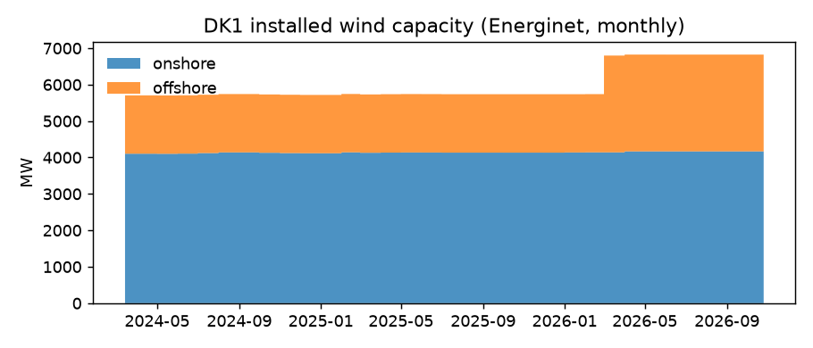
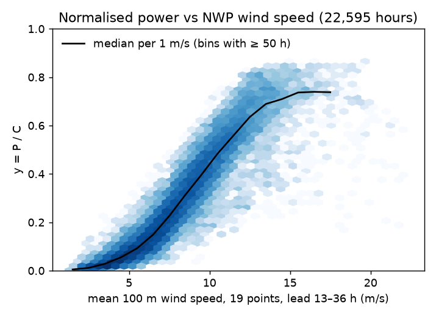

# Data check

Generated by `make data` for DK1, 2024-03-14 to 2026-10-25. 19 checks ok, 2 warnings.

## Summary

| check | status | detail |
|---|---|---|
| production: no duplicate stamps | ok | 0 duplicates |
| production: complete between first and last stamp | ok | 0 missing, longest gap 0 h |
| capacity: no duplicate stamps | ok | 0 duplicates |
| capacity: complete between first and last stamp | ok | 0 missing, longest gap 0 h |
| energinet_forecast: no duplicate stamps | ok | 0 duplicates |
| da_price: no duplicate stamps | ok | 0 duplicates |
| da_price: complete between first and last stamp | ok | 0 missing, longest gap 0 h |
| imbalance: no duplicate stamps | ok | 0 duplicates |
| NWP: every run present and usable | **warn** | 951/956 runs; missing or without complete 100 m wind: ['2025-08-05T00:00:00+00:00', '2025-08-06T00:00:00+00:00', '2025-08-07T00:00:00+00:00', '2025-08-08T00:00:00+00:00', '2025-08-09T00:00:00+00:00'] |
| NWP: every run complete | ok | 0 runs without 1387 rows |
| NWP: no missing values after lead 0 | **warn** | {'wind_speed_100m': 0, 'wind_direction_100m': 0, 'wind_speed_10m': 1368, 'wind_speed_120m': 0, 'wind_gusts_10m': 1368, 'temperature_2m': 1368, 'surface_pressure': 1368} |
| NWP: wind speed in [0, 60] m/s | ok | min 0.00, max 31.02 |
| NWP: direction in [0, 360] deg | ok | min 0, max 360 |
| Points: onshore on land, offshore at sea | ok | grid-cell elevation |
| Points: grid cell within 10 km | ok | max 7.2 km |
| Time: HourDK = HourUTC in Europe/Copenhagen | ok | 0 rows differ |
| Time: hours per local day match DST | ok | 0 days differ; DST day lengths seen: [23, 25] |
| Production: non-negative | ok | all four columns |
| Production: below installed capacity | ok | max P/C 0.865; 0 hours above 1 |
| Capacity: positive, no gaps | ok | 5702–6825 MW |
| Energinet forecast: within capacity | ok | max 0.695 |

## Coverage

UTC stamps, hour-beginning.

| table | freq | first | last | rows | missing | dupes | longest_gap |
|---|---|---|---|---|---|---|---|
| production | h | 2024-03-14 00:00 | 2026-10-16 23:00 | 22728 | 0 | 0 | 0 h |
| capacity | h | 2024-03-14 00:00 | 2026-10-25 23:00 | 22944 | 0 | 0 | 0 h |
| energinet_forecast | h | 2024-03-14 00:00 | 2026-10-25 23:00 | 22727 | 217 | 0 | 72 h |
| da_price | h | 2024-03-14 00:00 | 2026-10-25 23:00 | 22944 | 0 | 0 | 0 h |
| imbalance | 15min | 2025-03-04 11:15 | 2026-10-25 23:45 | 57651 | 0 | 0 | 0 h |

## NWP: ECMWF IFS HRES 00 UTC runs

951 of 956 runs, leads 0–72 h, 19 points, 1,319,037 rows.

Missing upstream or without complete 100 m wind: 2025-08-05T00:00:00+00:00, 2025-08-06T00:00:00+00:00, 2025-08-07T00:00:00+00:00, 2025-08-08T00:00:00+00:00, 2025-08-09T00:00:00+00:00.

### Grid cells used

Onshore points use land cells, offshore points sea cells (Open-Meteo `cell_selection`).

| point | region | lat | lon | grid_lat | grid_lon | grid_elevation_m | distance_km |
|---|---|---|---|---|---|---|---|
| on_5750_1000 | onshore | 57.5 | 10.0 | 57.469 | 10.021 | 32.0 | 3.65 |
| on_5700_0850 | onshore | 57.0 | 8.5 | 56.977 | 8.544 | 35.0 | 3.7 |
| on_5700_0950 | onshore | 57.0 | 9.5 | 56.977 | 9.494 | 48.0 | 2.57 |
| on_5650_0850 | onshore | 56.5 | 8.5 | 56.485 | 8.42 | 40.0 | 5.19 |
| on_5650_0900 | onshore | 56.5 | 9.0 | 56.485 | 8.981 | 8.0 | 2.02 |
| on_5650_1000 | onshore | 56.5 | 10.0 | 56.555 | 9.938 | 53.0 | 7.25 |
| on_5600_0850 | onshore | 56.0 | 8.5 | 55.993 | 8.484 | 26.0 | 1.28 |
| on_5600_0900 | onshore | 56.0 | 9.0 | 55.993 | 9.037 | 38.0 | 2.42 |
| on_5550_0850 | onshore | 55.5 | 8.5 | 55.501 | 8.545 | 26.0 | 2.86 |
| on_5550_0950 | onshore | 55.5 | 9.5 | 55.501 | 9.455 | 33.0 | 2.86 |
| on_5550_1000 | onshore | 55.5 | 10.0 | 55.501 | 10.0 | 14.0 | 0.1 |
| on_5500_0900 | onshore | 55.0 | 9.0 | 55.009 | 8.964 | 12.0 | 2.49 |
| horns_rev_1 | offshore | 55.53 | 7.91 | 55.571 | 7.834 | 0.0 | 6.62 |
| horns_rev_2 | offshore | 55.6 | 7.58 | 55.571 | 7.652 | 0.0 | 5.53 |
| horns_rev_3 | offshore | 55.7 | 7.69 | 55.712 | 7.683 | 0.0 | 1.38 |
| vesterhav_nord | offshore | 56.68 | 8.06 | 56.696 | 8.096 | 0.0 | 2.84 |
| vesterhav_syd | offshore | 56.03 | 8.03 | 56.063 | 7.947 | 0.0 | 6.37 |
| anholt | offshore | 56.6 | 11.21 | 56.555 | 11.25 | 0.0 | 5.54 |
| thor | offshore | 56.36 | 7.76 | 56.344 | 7.826 | 0.0 | 4.42 |

## Ranges and units

| quantity | min | median | max |
|---|---|---|---|
| wind production (MW) | 0 | 1435 | 5155 |
| capacity (MW) | 5702 | 5737 | 6825 |
| normalised power y = P / C | 0.000 | 0.240 | 0.865 |
| day-ahead price (EUR/MWh) | -60.0 | 88.4 | 936.3 |

Hours with day-ahead price ≤ 0 EUR/MWh (curtailment flag, Step 2): 1143 of 22944 (5.0%).

## Figures

## Provenance

- Download window: 2024-03-14 to 2026-10-25 (UTC days).
- Energi Data Service chunks downloaded 2026-10-26 to 2026-10-26; settlement data is revised for up to two years, so these dates define the snapshot.
- NWP: `ecmwf_ifs` 00 UTC runs from the Open-Meteo Single Runs API. Runs are assumed usable 7 h after initialisation (observed 6.1–6.5 h on 2026-10-26/27), before the 09:00 UTC summer issue time.
- Sources: Energinet (www.energidataservice.dk), CC BY 4.0; weather data by Open-Meteo.com (ECMWF), CC BY 4.0.
