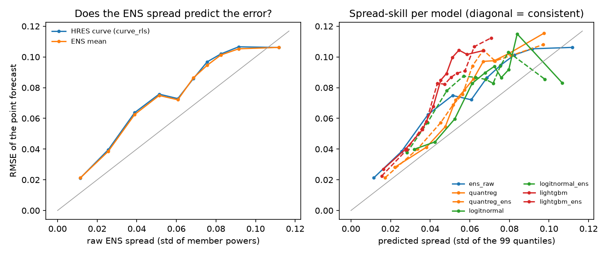
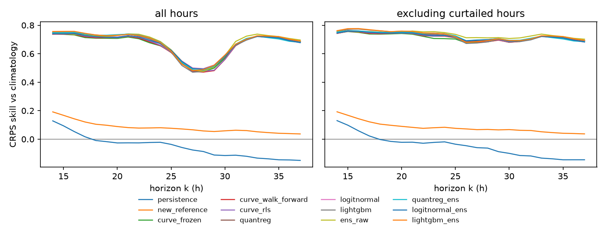
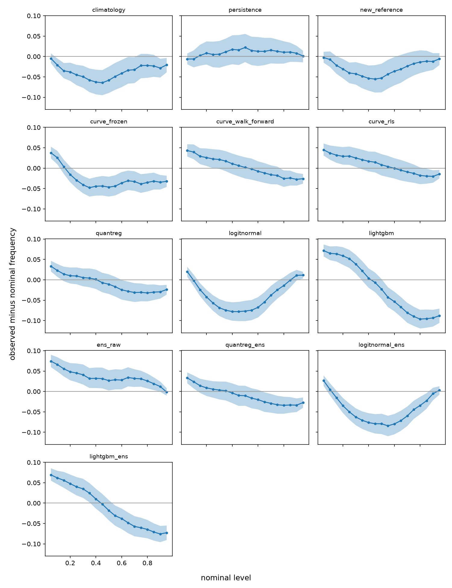
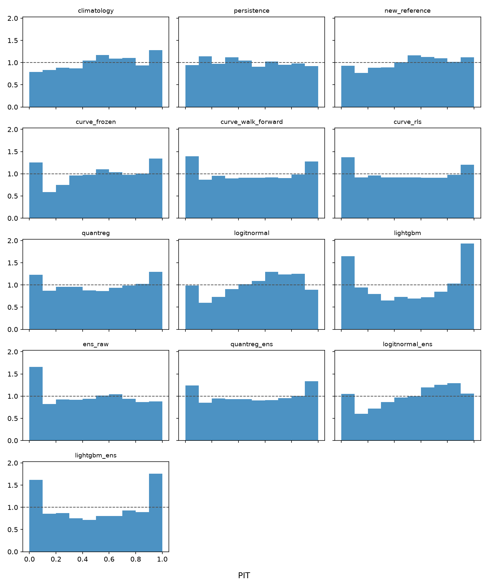
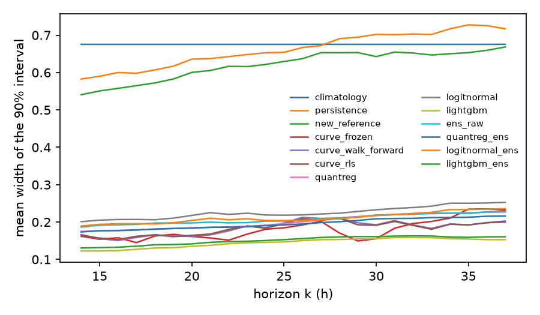

# Test-year evaluation

Generated by `make evaluate`. Test period 2025-03-01 to 2026-02-28: 361 days, 8664 day-ahead product hours forecast by every model (502 curtailed). Scores in units of capacity; MAE and RMSE in % of capacity.

## All hours

Skill = 1 − CRPS / CRPS(climatology); [lo, hi] = 90% day-block bootstrap band. `cover_x` / `width_x` = coverage and mean width of the central x interval.

| model | hours | crps | mae_pct | rmse_pct | skill | skill_lo | skill_hi | cover_0.5 | width_0.5 | cover_0.8 | width_0.8 | cover_0.9 | width_0.9 |
|---|---|---|---|---|---|---|---|---|---|---|---|---|---|
| climatology | 8664 | 0.1259 | 18.25 | 22.97 | +0.0% | +0.0% | +0.0% | 52.3% | 0.343 | 79.2% | 0.563 | 88.4% | 0.676 |
| persistence | 8664 | 0.1327 | 18.87 | 24.55 | -5.4% | -12.2% | +1.0% | 50.8% | 0.280 | 81.4% | 0.540 | 90.7% | 0.662 |
| new_reference | 8664 | 0.1157 | 16.59 | 20.27 | +8.1% | +5.5% | +10.6% | 52.3% | 0.305 | 79.5% | 0.511 | 89.7% | 0.620 |
| curve_frozen | 8664 | 0.0426 | 5.62 | 8.26 | +66.2% | +63.6% | +68.6% | 49.1% | 0.074 | 74.0% | 0.140 | 83.0% | 0.180 |
| curve_walk_forward | 8664 | 0.0426 | 5.61 | 8.24 | +66.2% | +63.5% | +68.5% | 46.0% | 0.069 | 73.3% | 0.139 | 83.1% | 0.184 |
| curve_rls | 8664 | 0.0421 | 5.56 | 8.18 | +66.6% | +63.8% | +69.0% | 45.8% | 0.069 | 74.3% | 0.139 | 84.1% | 0.184 |
| quantreg | 8664 | 0.0414 | 5.56 | 8.18 | +67.1% | +64.7% | +69.3% | 46.0% | 0.078 | 74.8% | 0.153 | 84.3% | 0.201 |
| logitnormal | 8664 | 0.0416 | 5.56 | 8.18 | +67.0% | +64.4% | +69.2% | 53.2% | 0.089 | 81.2% | 0.175 | 89.1% | 0.225 |
| lightgbm | 8664 | 0.0413 | 5.56 | 8.18 | +67.2% | +64.6% | +69.5% | 35.8% | 0.059 | 64.2% | 0.114 | 74.0% | 0.144 |
| ens_raw | 8664 | 0.0406 | 5.47 | 8.10 | +67.8% | +65.2% | +70.1% | 48.6% | 0.087 | 74.6% | 0.165 | 82.4% | 0.208 |
| quantreg_ens | 8664 | 0.0410 | 5.56 | 8.18 | +67.4% | +65.0% | +69.6% | 46.2% | 0.079 | 74.3% | 0.150 | 83.9% | 0.195 |
| logitnormal_ens | 8664 | 0.0416 | 5.56 | 8.18 | +67.0% | +64.4% | +69.3% | 50.6% | 0.084 | 79.0% | 0.163 | 87.6% | 0.211 |
| lightgbm_ens | 8664 | 0.0407 | 5.56 | 8.18 | +67.7% | +65.1% | +70.0% | 40.0% | 0.065 | 66.3% | 0.121 | 75.8% | 0.151 |

## Excluding curtailed hours (day-ahead price ≤ 0)

| model | hours | crps | skill | mae_pct | rmse_pct |
|---|---|---|---|---|---|
| climatology | 8162 | 0.1283 | +0.0% | 18.68 | 23.42 |
| persistence | 8162 | 0.1345 | -4.8% | 19.12 | 24.86 |
| new_reference | 8162 | 0.1176 | +8.3% | 16.88 | 20.59 |
| curve_frozen | 8162 | 0.0366 | +71.5% | 4.92 | 6.71 |
| curve_walk_forward | 8162 | 0.0362 | +71.8% | 4.91 | 6.67 |
| curve_rls | 8162 | 0.0357 | +72.2% | 4.86 | 6.61 |
| quantreg | 8162 | 0.0355 | +72.3% | 4.86 | 6.61 |
| logitnormal | 8162 | 0.0359 | +72.0% | 4.86 | 6.61 |
| lightgbm | 8162 | 0.0353 | +72.5% | 4.86 | 6.61 |
| ens_raw | 8162 | 0.0340 | +73.5% | 4.69 | 6.36 |
| quantreg_ens | 8162 | 0.0353 | +72.5% | 4.86 | 6.61 |
| logitnormal_ens | 8162 | 0.0358 | +72.1% | 4.86 | 6.61 |
| lightgbm_ens | 8162 | 0.0347 | +73.0% | 4.86 | 6.61 |

## Point forecasts against Energinet's day-ahead forecast

On the 8472 hours Energinet's forecast covers. It is issued at 18:00 on D−1 with newer weather data, seven hours after this project's issue time, and it excludes Thor: a benchmark with an edge. As published it runs low against settled production (it does not cover the same plants), so it is also shown after a linear recalibration fitted on the training period only.

| model | mae_pct | rmse_pct |
|---|---|---|
| climatology | 18.15 | 22.88 |
| persistence | 18.84 | 24.44 |
| new_reference | 16.51 | 20.19 |
| curve_frozen | 5.64 | 8.30 |
| curve_walk_forward | 5.63 | 8.28 |
| curve_rls | 5.58 | 8.22 |
| quantreg | 5.58 | 8.22 |
| logitnormal | 5.58 | 8.22 |
| lightgbm | 5.58 | 8.22 |
| ens_raw | 5.50 | 8.15 |
| quantreg_ens | 5.58 | 8.22 |
| logitnormal_ens | 5.58 | 8.22 |
| lightgbm_ens | 5.58 | 8.22 |
| energinet, as published | 7.45 | 9.96 |
| energinet, recalibrated (1.33 F -227 MW) | 4.97 | 6.91 |

## Ensemble NWP (Step 8)

Each `_ens` layer adds the spread of the ECMWF ENS members' power (51 members through the same RLS curve) as a covariate; `ens_raw` is the members' quantiles without post-processing, against the HRES curve with empirical errors. DM < 0: the ENS model is better.

| model | against | crps_without | crps_with | change | dm | p |
|---|---|---|---|---|---|---|
| ens_raw | curve_rls | 0.0421 | 0.0406 | -3.6% | -2.96 | 0.003 |
| quantreg_ens | quantreg | 0.0414 | 0.0410 | -0.9% | -1.36 | 0.173 |
| logitnormal_ens | logitnormal | 0.0416 | 0.0416 | +0.0% | +0.03 | 0.978 |
| lightgbm_ens | lightgbm | 0.0413 | 0.0407 | -1.5% | -3.24 | 0.001 |

## Diebold–Mariano tests on daily mean CRPS

Statistic of the row model minus the column model; negative means the row model is better. |DM| > 1.96 is significant at 5 % (Newey–West variance, 7 lags).

| model | climatology | persistence | new_reference | curve_frozen | curve_walk_forward | curve_rls | quantreg | logitnormal | lightgbm | ens_raw | quantreg_ens | logitnormal_ens | lightgbm_ens |
|---|---|---|---|---|---|---|---|---|---|---|---|---|---|
| climatology | – | -0.8 | +2.9 | +12.2 | +11.8 | +11.7 | +12.1 | +12.1 | +12.0 | +11.9 | +12.3 | +12.1 | +12.2 |
| persistence | +0.8 | – | +3.4 | +12.8 | +13.0 | +13.2 | +13.5 | +13.3 | +13.1 | +13.8 | +13.6 | +13.3 | +13.4 |
| new_reference | -2.9 | -3.4 | – | +14.7 | +14.5 | +14.3 | +15.1 | +15.0 | +14.7 | +14.8 | +15.4 | +14.9 | +15.1 |
| curve_frozen | -12.2 | -12.8 | -14.7 | – | -0.0 | +0.8 | +1.5 | +2.3 | +2.1 | +2.3 | +2.0 | +2.4 | +3.2 |
| curve_walk_forward | -11.8 | -13.0 | -14.5 | +0.0 | – | +1.8 | +2.2 | +3.0 | +2.5 | +3.1 | +2.7 | +3.0 | +3.8 |
| curve_rls | -11.7 | -13.2 | -14.3 | -0.8 | -1.8 | – | +1.3 | +1.3 | +1.4 | +3.0 | +1.9 | +1.3 | +2.6 |
| quantreg | -12.1 | -13.5 | -15.1 | -1.5 | -2.2 | -1.3 | – | -0.3 | +0.1 | +1.2 | +1.4 | -0.3 | +1.0 |
| logitnormal | -12.1 | -13.3 | -15.0 | -2.3 | -3.0 | -1.3 | +0.3 | – | +0.5 | +1.5 | +1.0 | -0.0 | +2.3 |
| lightgbm | -12.0 | -13.1 | -14.7 | -2.1 | -2.5 | -1.4 | -0.1 | -0.5 | – | +1.0 | +0.4 | -0.5 | +3.2 |
| ens_raw | -11.9 | -13.8 | -14.8 | -2.3 | -3.1 | -3.0 | -1.2 | -1.5 | -1.0 | – | -0.7 | -1.5 | -0.2 |
| quantreg_ens | -12.3 | -13.6 | -15.4 | -2.0 | -2.7 | -1.9 | -1.4 | -1.0 | -0.4 | +0.7 | – | -1.0 | +0.5 |
| logitnormal_ens | -12.1 | -13.3 | -14.9 | -2.4 | -3.0 | -1.3 | +0.3 | +0.0 | +0.5 | +1.5 | +1.0 | – | +2.2 |
| lightgbm_ens | -12.2 | -13.4 | -15.1 | -3.2 | -3.8 | -2.6 | -1.0 | -2.3 | -3.2 | +0.2 | -0.5 | -2.2 | – |

## Figures

