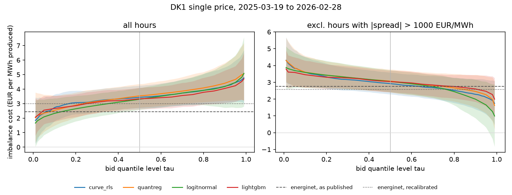
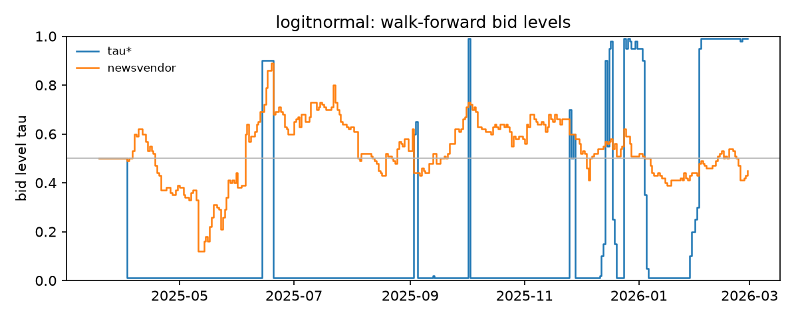

# DK1 imbalance-market backtest

Generated by `make market`. Window 2025-03-19 to 2026-02-28 (single imbalance price): 335 days, 8040 hours bid by every model and by Energinet. A price-taking 100 MW portfolio produces y x 100 MW and bids one quantile of its forecast day-ahead; hourly bids are settled per 15 minutes against the hourly mean price. Cost = revenue lost against a perfect bid, sum (lambda_DA - lambda_imb)(E - b) / sum E, in EUR per MWh produced (lower is better; negative = earned). Bands are 90% day-block bootstrap bands.

## Cost by bid strategy (EUR/MWh)

`tau*` and `newsvendor` choose a level each day from the trailing 60 complete days (median until 14 days exist). The last two columns are the best fixed level in hindsight (and its cost), over all hours and over the hours with |lambda_DA - lambda_imb| <= 1000 EUR/MWh; they are not strategies.

| model | mean | median | tau* | newsvendor | median, 90% band | best tau, all hours | best tau, spread <= 1000 |
|---|---|---|---|---|---|---|---|
| climatology | 2.39 | 1.88 | -0.32 | 2.27 | -0.34 to 4.10 | 0.01 (-0.46) | 0.99 (-2.82) |
| quantreg | 3.50 | 3.53 | 2.29 | 3.81 | 2.73 to 4.36 | 0.01 (2.03) | 0.99 (1.62) |
| curve_frozen | 3.30 | 3.28 | 2.23 | 3.53 | 2.54 to 4.07 | 0.01 (2.18) | 0.99 (1.33) |
| persistence | 1.34 | 0.83 | -0.54 | 0.51 | -1.64 to 3.12 | 0.06 (-1.01) | 0.99 (-2.64) |
| lightgbm | 3.33 | 3.33 | 2.70 | 3.55 | 2.61 to 4.10 | 0.01 (2.07) | 0.99 (2.00) |
| logitnormal | 3.29 | 3.30 | 2.62 | 3.75 | 2.57 to 4.08 | 0.01 (1.66) | 0.99 (0.99) |
| new_reference | 2.22 | 1.78 | -0.82 | 2.61 | -0.27 to 3.80 | 0.02 (-0.62) | 0.99 (-2.54) |
| curve_rls | 3.44 | 3.43 | 1.81 | 3.63 | 2.69 to 4.24 | 0.01 (1.84) | 0.99 (1.75) |
| curve_walk_forward | 3.47 | 3.45 | 2.05 | 3.67 | 2.69 to 4.28 | 0.01 (1.86) | 0.99 (1.72) |

## logitnormal against its alternatives

Saving = cost of logitnormal's median bid minus cost of the bid (positive = cheaper), with a paired band over the same days. Energinet's forecast is issued at 18:00, after gate closure: an information edge.

| bid | cost | 90% band | saving vs median | 90% band | excl. curtailed |
|---|---|---|---|---|---|
| logitnormal, mean | 3.29 | 2.54 to 4.07 | +0.01 | -0.14 to +0.16 | 3.53 |
| logitnormal, median | 3.30 | 2.57 to 4.08 | +0.00 | +0.00 to +0.00 | 3.54 |
| logitnormal, tau* | 2.62 | 1.18 to 4.04 | +0.68 | -0.57 to +1.91 | 3.00 |
| logitnormal, newsvendor | 3.75 | 2.87 to 4.77 | -0.45 | -0.92 to -0.07 | 4.01 |
| climatology, median | 1.88 | -0.34 to 4.10 | +1.42 | -0.91 to +3.81 | 2.16 |
| persistence, median | 0.83 | -1.64 to 3.12 | +2.47 | +0.13 to +4.97 | 0.85 |
| new_reference, median | 1.78 | -0.27 to 3.80 | +1.52 | -0.51 to +3.69 | 1.97 |
| energinet, as published | 2.44 | 1.60 to 3.29 | +0.87 | +0.02 to +1.76 | 2.70 |
| energinet, recalibrated | 2.99 | 2.33 to 3.72 | +0.31 | -0.22 to +0.83 | 3.26 |

Levels chosen for logitnormal (mean, 10-90 % range): tau* 0.19 (0.01 to 0.95), newsvendor 0.53 (0.38 to 0.68).

## What drives the cost of the median bid

With s = lambda_DA - lambda_imb and e = E - b, sum s e = sum (s - s_bar)(e - e_bar) + n s_bar e_bar. The covariance part prices how the own error moves with the spread; the mean-spread part is the bid's bias times the mean spread, a bet rather than a property of the forecast. 30 hours (0.4%) have |spread| > 1000 EUR/MWh (largest 3242); the mean spread is -3.2 EUR/MWh over all hours and +2.8 over the rest.

| model | MAE (MW) | cost | covariance part | mean-spread part | corr(s, e) |
|---|---|---|---|---|---|
| climatology | 18.1 | 1.88 | +2.65 | -0.77 | +0.026 |
| quantreg | 5.8 | 3.53 | +3.48 | +0.05 | +0.084 |
| curve_frozen | 5.7 | 3.28 | +3.28 | +0.00 | +0.082 |
| persistence | 19.0 | 0.83 | +0.75 | +0.08 | +0.006 |
| lightgbm | 5.6 | 3.33 | +3.31 | +0.02 | +0.084 |
| logitnormal | 5.7 | 3.30 | +3.33 | -0.03 | +0.083 |
| new_reference | 16.7 | 1.78 | +2.39 | -0.61 | +0.025 |
| curve_rls | 5.6 | 3.43 | +3.34 | +0.09 | +0.084 |
| curve_walk_forward | 5.7 | 3.45 | +3.37 | +0.08 | +0.084 |

## Position against the system

Hours by the sign of logitnormal's median-bid imbalance, the share in which the system was short, and the mean effective penalty per MWh (EUR/MWh; positive = a cost).

| own position | hours | MWh | system short | penalty |
|---|---|---|---|---|
| short (E < b): pays lambda_imb - lambda_DA | 3469 | 21584 | 37% | +15.9 |
| long (E > b): forgoes lambda_DA - lambda_imb | 4571 | 24086 | 27% | +19.4 |

Correlation of the own imbalance E - b (MW) with the system imbalance: -0.08. Whole-window newsvendor level c_down / (c_up + c_down) = 0.55 (hindsight).

## Figures

