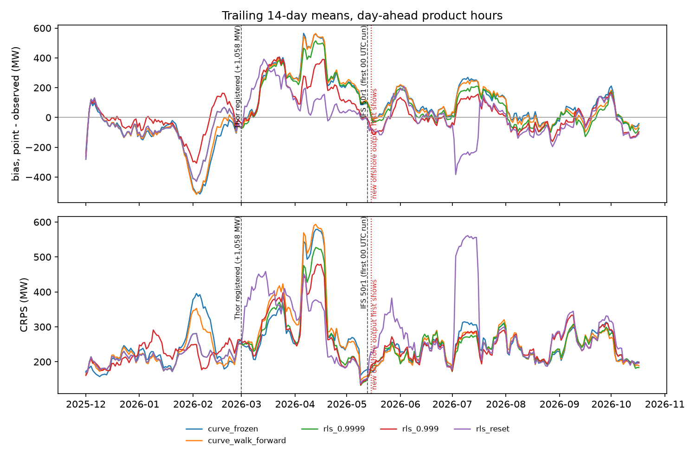
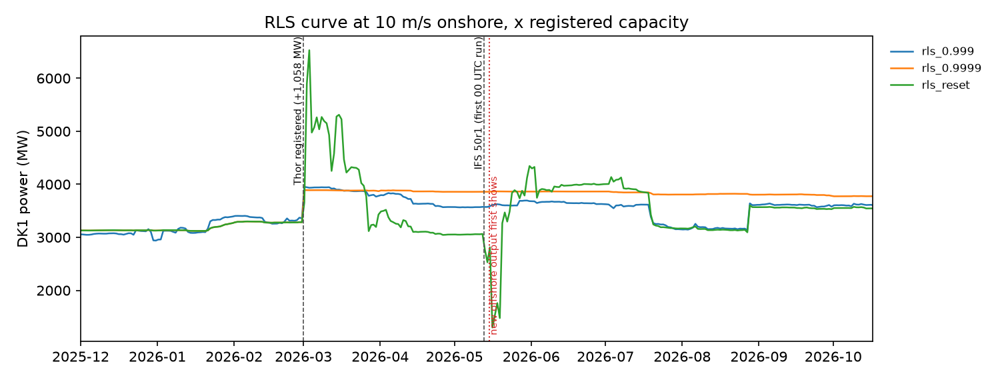

# Regime change: Thor and IFS 50r1

Generated by `make stress`. Events: 2026-03-01: Thor registered (+1,058 MW); 2026-05-13: IFS 50r1 (first 00 UTC run). New offshore output first shows on 2026-05-15 02:00 UTC (offshore production above its maximum of the year before).

All scores in MW on the day-ahead product hours every model forecast: test year (8,664 hours, stable fleet) and stress period (5,521 hours). Forecasts in MW are the quantiles times the capacity known at issue time; the register counts Thor in full from its first event, months before Thor produces. `rls_<lambda>`: the RLS curve with forgetting lambda (memory ~ 1 / (1 - lambda) rows, ~37 a day); `rls_reset`: lambda = 0.9999 with the covariance reset at every event.

## Scores (MW)

| model | hours test | hours stress | bias_mw test | bias_mw stress | mae_mw test | mae_mw stress | rmse_mw test | rmse_mw stress | crps_mw test | crps_mw stress |
|---|---|---|---|---|---|---|---|---|---|---|
| curve_frozen | 8,664 | 5,521 | +5 | +133 | 322 | 343 | 474 | 543 | 244 | 263 |
| curve_walk_forward | 8,664 | 5,521 | +12 | +127 | 322 | 339 | 473 | 530 | 244 | 268 |
| rls_0.999 | 8,664 | 5,521 | +22 | +58 | 324 | 334 | 472 | 516 | 245 | 256 |
| rls_0.9995 | 8,664 | 5,521 | +24 | +65 | 319 | 325 | 459 | 495 | 242 | 249 |
| rls_0.9998 | 8,664 | 5,521 | +20 | +85 | 317 | 330 | 462 | 500 | 241 | 253 |
| rls_0.9999 | 8,664 | 5,521 | +17 | +102 | 317 | 333 | 464 | 508 | 240 | 256 |
| rls_1 | 8,664 | 5,521 | +15 | +124 | 319 | 337 | 469 | 524 | 241 | 260 |
| rls_reset | 8,664 | 5,521 | +17 | +17 | 317 | 370 | 464 | 606 | 240 | 289 |

## Forgetting: tracking against variance

Shorter memory tracks the change: the stress-period bias falls from +124 MW (rls_1) to +58 MW (rls_0.999), while the test-year CRPS rises from 240 MW (rls_0.9999) to 245 MW (rls_0.999). The best lambda by CRPS is rls_0.9999 in the stable test year and rls_0.9995 under change: no single memory suits both, the trade-off of exponential forgetting.

`rls_reset` removes the bias (+17 MW) but has the worst stress CRPS (289 MW). Resetting P to delta I forgets the precision of all 64 parameters, not only those the event changed, so the curve swings until the data pin it down again (curve-level figure). A partial reset (P + alpha I) or one limited to the offshore block would be the next step; it is not tuned here, since the stress period is the evaluation.

## Figures

